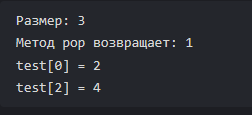

# Лабораторная работа №2: Анализ сложности алгоритмов. Шаблоны классов

**Студент:** Хвостов Ростислав Романович

**Группа:** ПИЖ-б-о-25-2

**Вариант:** 11

## Цель работы
Научиться оценивать эффективность алгоритмов с помощью О-нотации (Big O). Освоить классы сложности: O(1), O(log n), O(n), O(n log n), O(n²). Научиться проводить экспериментальный анализ производительности алгоритмов. Освоить создание шаблонов функций и классов для работы с различными типами данных. Получить навыки сравнения производительности различных реализаций одной задачи.

## Теоретическое обоснование
- Анализ сложности - это математический способ оценки эффективности алгоритма в зависимости от размера входных данных.
- О-нотация - это математическая запись, описывающая асимптотическое поведение функции при стремлении аргумента к бесконечности.

## Задание
**Общее задание:**
Реализовать шаблонный контейнер с заданной функциональностью. Провести анализ сложности каждой операции. Экспериментально сравнить производительность с аналогом из STL.

**Задание варианта:**
Реализовать класс RingBuffer<T> с методами: push, pop, operator[], isEmpty, isFull.

**Код к заданию:**
```c++
#include <iostream>
#include <stdexcept>

using namespace std;

template <typename T, unsigned int buffer_size>
class RingBuffer {
private:
	T buffer[buffer_size];
	unsigned int first;
	unsigned int last;
	bool full;

public:
	RingBuffer() : first(0), last(0), full(false) {}

	void push(const T& value) {
		if (full) {
			throw overflow_error("Буфер полон");
		}
		buffer[last] = value;
		last = (last + 1) % buffer_size;
		full = first == last;
	}

	T pop() {
		if (isEmpty()) {
			throw underflow_error("Буфер пуст");
		}
		T value = buffer[first];
		first = (first + 1) % buffer_size;
		full = false;
		return value;
	}

	T& operator[](unsigned int index) {
		if (index >= size()) {
			throw out_of_range("Индекс выходит за границы буфера");
		}
		return buffer[(first + index) % buffer_size];
	}

	bool isEmpty() const {
		return !full && (first == last);
	}

	bool isFull() const {
		return full;
	}

	unsigned int size() const {
		if (full) {
			return buffer_size;
		}
		return (last + buffer_size - first) % buffer_size;
	}

	unsigned int capacity() const {
		return buffer_size;
	}
};

int main() {
	setlocale(LC_ALL, "ru");

	RingBuffer<int, 3> test;

	test.push(1);
	test.push(2);
	test.push(3);

	cout << "Размер: " << test.size() << endl;
	cout << "Метод pop возвращает: " << test.pop() << endl;

	test.push(4);

	cout << "test[0] = " << test[0] << endl;
	cout << "test[2] = " << test[2] << endl;

	return 0;
}
```



Результат выполнения кода

Все операции имеют сложность O(1), так как в любом случае содержат только по одному обращению к массиву.
Аналогов этому классу в STL нет.

## Контрольные вопросы
1. Что такое О-нотация (Big O) и зачем она нужна?
Ответ: О-нотация описывает верхнюю границу роста времени выполнения алгоритма в зависимости от размера входных данных. Нужна для сравнения алгоритмов по эффективности.

2. Какая сложность у доступа к элементу массива по индексу? Почему?
Ответ: Сложность доступа к элементу массива по индексу - O(1), так как адрес элемента вычисляется за одну операцию: адрес плюс индекс, умноженный на размер элемента.

3. Какая сложность у бинарного поиска? Почему?
Ответ: Сложность бинарного поиска - O(log n). Потому что на каждом шаге область поиска уменьшается вдвое, пока не останется один элемент.

4. Что означает сложность O(n log n)? Приведите пример алгоритма.
Ответ: O(n log n) означает, что время растёт быстрее линейного, но медленнее квадратичного. Пример: быстрая сортировка.

5. Что такое амортизированный анализ? Приведите пример.
Ответ: Амортизированный анализ оценивает среднюю стоимость операции в худшем случае за длинную последовательность операций. Пример: добавление в вектор в среднем O(1), хотя иногда происходит перевыделение памяти за O(n).

6. Какая сложность у двух вложенных циклов по n итераций каждый?
Ответ: Сложность двух вложенных циклов по n итераций - O(n^2). Потому что внутренний цикл выполняется n раз для каждой из n итераций внешнего.

7. Какая сложность у рекурсивного вычисления чисел Фибоначчи?
Ответ: Сложность рекурсивного вычисления чисел Фибоначчи - O(2^n). Потому что каждый вызов порождает два новых вызова, и дерево рекурсии растёт экспоненциально.

8. Что такое шаблоны функций? Как их объявить и использовать?
Ответ: Шаблоны функций позволяют писать одну функцию для разных типов. Объявление: template <typename T>. Используется так же, как и обычная функция, но вместо типов указывается T.

9. Что такое шаблоны классов? Как их объявить и использовать?
Ответ: Шаблоны классов позволяют писать один класс для разных типов. Объявление и использование аналогично шаблону функции.

10. В чём преимущество шаблонов перед перегрузкой функций?
Ответ: Преимущество шаблонов перед перегрузкой функций в том, что не нужно писать отдельную реализацию для каждого типа. Один шаблон автоматически работает с любым подходящим типом.

11. Как указать, что шаблонный параметр - тип?
Ответ: Указать, что шаблонный параметр - тип, можно с помощью typename.

12. Можно ли создать шаблон с несколькими параметрами типов?
Ответ: Да, можно создать шаблон с несколькими параметрами типов.

13. Как провести экспериментальное измерение времени выполнения?
Ответ: Экспериментальное измерение времени выполнения проводится с помощью библиотеки <chrono>. Засекается время до и после операции и вычисляется разницу.

14. Почему при измерении времени нужно выполнять операцию многократно?
Ответ: Операцию нужно выполнять многократно, чтобы сгладить случайные колебания и получить статистически устойчивое среднее время, так как однократное измерение может быть неточным.

15. Что важнее: сложность алгоритма или константа?
Ответ: Важнее сложность алгоритма, потому что при больших n она определяет рост времени. Константа важна только при малых n или при сравнении алгоритмов с одинаковой сложностью.

## Вывод
Научились оценивать эффективность алгоритмов с помощью О-нотации (Big O). Освоили классы сложности: O(1), O(log n), O(n), O(n log n), O(n²). Научились проводить экспериментальный анализ производительности алгоритмов. Освоили создание шаблонов функций и классов для работы с различными типами данных. Получили навыки сравнения производительности различных реализаций одной задачи.
