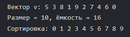

# Лабораторная работа №3: Шаблонный класс Vector и управление памятью

**Студент:** Хвостов Ростислав Романович

**Группа:** ПИЖ-б-о-25-2

**Вариант:** 11

## Цель работы
Освоить управление динамической памятью (выделение, расширение, освобождение) при реализации шаблонного контейнера `Vector<T>`. Закрепить «правило трёх» и освоить «правило пяти» (копирование и перемещение). Реализовать итераторы для поддержки range-based for и STL-совместимости. Провести амортизированный анализ операции `push_back`.

## Теоретическое обоснование
- **Динамический массив** - структура данных, хранящая элементы в непрерывной области памяти, размер которой может изменяться во время выполнения программы.
- **Амортизированный анализ** - оценка средней стоимости операции за длинную последовательность операций.
- **Правило трёх** - классу нужны деструктор, конструктор копирования и оператор присваивания копированием, если есть хотябы одно из этого.
- **Правило пяти** - правило трёх + конструктор перемещения и оператор присваивания перемещением.
- **Итератор** - объект, указывающий на элемент массива и позволяющий перебирать элементы последовательно.

## Задание
**Задание:** Реализовать шаблонный класс `Vector<T>` - аналог `std::vector` - с нуля: конструкторы (по умолчанию, размера, копирования, перемещения), деструктор, операторы присваивания (копированием и перемещением), доступ по индексу, методы `size`, `capacity`, `empty`, `push_back`, `pop_back`, `reserve`, `resize`, `clear`, `swap`, итераторы `begin`/`end` (константные и неконстантные). Реализовать «правило пяти» и корректную обработку ошибок (выход за границы). Реализация быстрой сортировки.

**Код к заданию:**
```c++
#include <iostream>
#include <stdexcept>
#include <utility>


using namespace std;

template <typename T>
class Vector {
private:
    T* data;
    int size;
    int capacity;

    void quickSortImpl(int left, int right) {
        if (left >= right) return;
        
        int i = left;
        int j = right;
        T mid = data[(left + right) / 2];
        
        while (i <= j) {
            while (data[i] < mid) {
                ++i;
            }
            
            while (data[j] > mid) {
                --j;
            }
            
            if (i <= j) {
                swap(data[i], data[j]);
                ++i;
                --j;
            }
        }
        quickSortImpl(left, j);
        quickSortImpl(i, right);
    }

public:
    Vector() : data(nullptr), size(0), capacity(0) {}

    explicit Vector(int n) : data(new T[n]()), size(n), capacity(n) {}

    Vector(const Vector& other) : data(new T[other.capacity]), size(other.size), capacity(other.capacity) {
        for (int i = 0; i < size; ++i) data[i] = other.data[i];
    }

    Vector(Vector&& other) noexcept : data(other.data), size(other.size), capacity(other.capacity) {
        other.data = nullptr;
        other.size = other.capacity = 0;
    }

    ~Vector() { delete[] data; }

    Vector& operator=(const Vector& other) {
        if (this != &other) {
            Vector temp(other);
            vector_swap(temp);
        }
        return *this;
    }

    Vector& operator=(Vector&& other) noexcept {
        if (this != &other) {
            delete[] data;
            
            data = other.data;
            size = other.size;
            capacity = other.capacity;
            
            other.data = nullptr;
            other.size = 0;
            other.capacity = 0;
        }
        return *this;
    }

    T& operator[](int index) {
        if (index < 0 || index >= size) {
            throw out_of_range("Индекс выходит за границы вектора");
        }
        return data[index];
    }
    
    const T& operator[](int index) const {
        if (index < 0 || index >= size) {
            throw out_of_range("Индекс выходит за границы вектора");
        }
        return data[index];
    }

    int getSize() const {
        return size;
    }
    
    int getCapacity() const {
        return capacity;
    }
    
    bool empty() const {
        return size == 0;
    }

    void reserve(int newCapacity) {
        if (newCapacity <= capacity) return;
        T* newData = new T[newCapacity];
        
        for (int i = 0; i < size; ++i) {
            newData[i] = data[i];
        }
        
        delete[] data;
        data = newData;
        capacity = newCapacity;
    }

    void push_back(const T& value) {
        if (size >= capacity) {
            reserve((capacity == 0) ? 1 : capacity * 2);
        }
        
        data[size++] = value;
    }

    void pop_back() {
        if (empty()) {
            throw underflow_error("Вектор пуст");
        }
        
        --size;
    }

    void clear() {
        size = 0;
    }

    void vector_swap(Vector& other) noexcept {
        swap(data, other.data);
        swap(size, other.size);
        swap(capacity, other.capacity);
    }

    T* begin() {
        return data;
    }
    
    T* end() {
        return data + size;
    }
    
    const T* begin() const {
        return data;
    }
    
    const T* end() const {
        return data + size;
    }

    void quickSort() {
        if (size > 1) {
            quickSortImpl(0, size - 1);
        }
    }
};

int main() {
    setlocale(LC_ALL, "ru");

    Vector<int> v;
    for (int x : {5, 3, 8, 1, 9, 2, 7, 4, 6, 0}) {
        v.push_back(x);
    }

    cout << "Вектор v: ";
    for (int i : v) {
        cout << i << " ";
    }
    
    cout << "\nРазмер = " << v.getSize() << ", ёмкость = " << v.getCapacity() << endl;

    v.quickSort();
    cout << "Сортировка: ";
    for (int i : v) {
        cout << i << " ";
    }
    
    return 0;
}
```


Результат выполнения кода

## Контрольные вопросы
1. **Почему динамический массив называется «динамическим»?**
Ответ: Потому что его размер определяется во время выполнения программы и может изменяться, а память выделяется в куче, а не на этапе компиляции.

2. **Что такое ёмкость (capacity) и чем она отличается от размера (size)?**
Ответ: `size` - количество реально хранящихся элементов, а `capacity` - количество выделенной памяти, достаточной для хранения элементов.

3. **Почему при расширении массива ёмкость удваивается, а не увеличивается на фиксированное число?**
Ответ: Удвоение даёт геометрический рост и суммарно O(n) копирований, обеспечивая амортизированную O(1) на `push_back`.

4. **Какова амортизированная сложность операции `push_back`? Почему?**
Ответ: O(1). В среднем на одну вставку приходится константное число операций.

5. **Что такое «правило трёх»? Когда оно применяется?**
Ответ: Классу нужны деструктор, конструктор копирования и оператор присваивания копированием, если есть хотябы одно из этого.

6. **Что такое «правило пяти»? Чем оно отличается от «правила трёх»?**
Ответ: Правило трёх + конструктор перемещения и оператор присваивания перемещением. Это позволяет дешёво передавать владение ресурсом без копирования.

7. **В чём разница между конструктором копирования и оператором присваивания?**
Ответ: Конструктор копирования создаёт новый объект из существующего, а оператор присваивания изменяет уже существующий объект.

8. **Зачем нужна проверка `if (this != &other)` в операторе присваивания?**
Ответ: Защита от самоприсваивания.

9. **Что такое итератор? Как он связан с указателем?**
Ответ: Итератор - указатель на элемент контейнера, позволяющий перебирать элементы.

10. **Зачем нужны методы `begin()` и `end()`?**
Ответ: Они задают полуинтервал `[begin, end)` для обхода контейнера, где `end` указывает на позицию за последним элементом.

11. **Как реализовать range-based for для своего контейнера?**
Ответ: Реализовать итераторы `begin()` и `end()`.

12. **Что такое «глубокое копирование»? Чем оно отличается от «поверхностного»?**
Ответ: Глубокое копирование копирует сами данные, поверхностное копирует только указатель.

13. **Что такое семантика перемещения и зачем она нужна?**
Ответ: Это передача владения ресурсом от одного объекта другому без копирования. Нужна для эффективности.

14. **Почему конструктор перемещения помечается `noexcept`?**
Ответ: Потому что он не выделяет память и не копирует элементы, значит, не может выбросить исключение.

15. **Как правильно освобождать память в деструкторе?**
Ответ: Вызвать `delete[] data;`.

## Вывод
Освоили управление динамической памятью при реализации шаблонного контейнера `Vector<T>`. Закрепили «правило трёх» и освоили «правило пяти», включая copy-and-swap и семантику перемещения. Реализовали итераторы для range-based for и STL-совместимости, а также быструю сортировку внутри класса. Провели амортизированный анализ `push_back` и проанализировали сложность всех операций.
