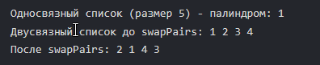

# Лабораторная работа №4: Односвязный и двусвязный списки

**Студент:** Хвостов Ростислав Романович

**Группа:** ПИЖ-б-о-25-2

**Вариант:** 11

## Цель работы
1. Реализовать шаблонный класс односвязного списка (SinglyLinkedList) с базовыми операциями
2. Реализовать шаблонный класс двусвязного списка (DoublyLinkedList) с базовыми операциями
3. Освоить операции вставки, удаления, поиска и обхода элементов в списках
4. Сравнить производительность и особенности использования односвязного и двусвязного списков
5. Научиться правильно управлять памятью при работе со списками (удаление узлов)

## Теоретическое обоснование
- Связный список - это структура данных, в которой элементы не хранятся в памяти непрерывно. Каждый узел содержит данные и указатель
на следующий (и/или предыдущий) узел

**Код к заданию:**

```с++
#include <iostream>
#include <stdexcept>
#include <vector>
#include <utility>


using namespace std;

template <typename T>
class SinglyLinkedList {
private:
    struct Node {
        T data;
        Node* next;
        Node(const T& value) : data(value), next(nullptr) {}
    };
    
    Node* head;
    Node* tail;
    int count;
    
public:
    SinglyLinkedList() : head(nullptr), tail(nullptr), count(0) {}
    
    ~SinglyLinkedList() {
        while (head != nullptr) {
            Node* temp = head;
            head = head->next;
            delete temp;
        }
        tail = nullptr;
        count = 0;
    }
    
    void push_front(const T& value) {
        Node* newNode = new Node(value);
        newNode->next = head;
        head = newNode;
        if (tail == nullptr) {
            tail = newNode;
        }
        count++;
    }
    
    void pop_front() {
        if (head == nullptr) {
            throw underflow_error("Список пуст");
        }
        Node* temp = head;
        head = head->next;
        delete temp;
        count--;
        
        if (head == nullptr) {
            tail = nullptr;
        }
    }
    
    int size() const {
        return count;
    }
    
    bool isPalindrome() {
        if (head == nullptr) {
            throw underflow_error("Список пуст");
        }
        
        vector<T> values;
        Node* current = head;
        while (current != nullptr) {
            values.push_back(current->data);
            current = current->next;
        }

        int left = 0;
        int right = values.size() - 1;
        while (left < right) {
            if (values[left] != values[right]) {
                return false;
            }
            left++;
            right--;
        }
        return true;
    }
};

template <typename T>
class DoublyLinkedList {
private:
    struct Node {
        T data;
        Node* prev;
        Node* next;
        Node(const T& value) : data(value), prev(nullptr), next(nullptr) {}
    };
    
    Node* head;
    Node* tail;
    int count;

public:
    DoublyLinkedList() : head(nullptr), tail(nullptr), count(0) {}
    
    ~DoublyLinkedList() {
        while (head != nullptr) {
            Node* temp = head;
            head = head->next;
            delete temp;
        }
        tail = nullptr;
        count = 0;
    }
    
    void push_back(const T& value) {
        Node* newNode = new Node(value);
        if (tail == nullptr) {
            head = tail = newNode;
        } else {
            tail->next = newNode;
            newNode->prev = tail;
            tail = newNode;
        }
        count++;
    }
    
    void pop_back() {
        if (tail == nullptr) {
            throw underflow_error("Список пуст");
        }
        Node* temp = tail;
        tail = tail->prev;
        if (tail != nullptr) {
            tail->next = nullptr;
        } else {
            head = nullptr;
        }
        delete temp;
        count--;
    }
    
    int size() const {
        return count;
    }

    void swapPairs() {
        if (count < 2) {
            throw underflow_error("Список слишком мал");
        }
        Node* current = head;
        while (current != nullptr && current->next != nullptr) {
            swap(current->data, current->next->data);
            current = current->next->next;
        }
    }

    void print() const {
        for (Node* curr = head; curr != nullptr; curr = curr->next) {
            cout << curr->data << " ";
        }
        cout << "\n";
    }
};

int main() {
    setlocale(LC_ALL, "ru");

    SinglyLinkedList<int> singleList;
    for (int x : {1, 2, 3, 2, 1}) {
        singleList.push_front(x);
    }
    
    cout << "Односвязный список (размер " << singleList.size() << ") - палиндром: " << singleList.isPalindrome() << endl;


    DoublyLinkedList<int> doublyList;
    for (int x : {1, 2, 3, 4}) {
        doublyList.push_back(x);
    }
    
    cout << "Двусвязный список до swapPairs: ";
    doublyList.print();
    doublyList.swapPairs();
    cout << "После swapPairs: ";
    doublyList.print();

    return 0;
}

```



Результат выполнения кода

Операции вставки и удаления в обоих списках выполняются за O(1). Методы swapPairs и isPalindrome выполняются за O(n), т. к. требуют прохода по всем элементам списка.

## Контрольные вопросы
1. Чем связный список отличается от динамического массива?
Ответ: Массив хранит элементы в одном непрерывном блоке памяти с доступом по индексу, а список хранит узлы в произвольных местах памяти, связывая их указателями.

2. Какие операции в односвязном списке выполняются за O(1)?
Ответ: Вставка и удаление в начале списка, вставка или удаление после известного узла, а также вставка в конец списка при наличии указателя tail.

3. Почему удаление из конца односвязного списка требует O(n) времени?
Ответ: Чтобы удалить последний узел, нужно обнулить ссылку next у предпоследнего узла, а для его поиска приходится пройти весь список с начала, т. к. обратных ссылок нет.

4. Какие преимущества даёт хранение указателя tail в односвязном списке?
Ответ: Указатель tail позволяет мгновенно обращаться к последнему элементу и добавлять новые узлы в конец списка за O(1).

5. Чем двусвязный список отличается от односвязного?
Ответ: Каждый узел двусвязного списка хранит два указателя: на следующий и предыдущий элементы, а односвязного - только на следующий.

6. Какие операции в двусвязном списке выполняются быстрее, чем в односвязном?
Ответ: Удаление с конца списка, удаление произвольного узла по ссылке на него и вставка перед заданным узлом.

7. Что такое «голова» (head) и «хвост» (tail) списка?
Ответ: head - это указатель на первый узел списка, а tail - указатель на последний узе.

8. Как удалить узел из середины односвязного списка?
Ответ: Нужно дойти до предыдущего узла и перенаправить его указатель в обход удаляемого элемента.

9. Как удалить узел из середины двусвязного списка? Почему это проще?
Ответ: Нужно напрямую связать соседей удаляемого узла. Это проще, т. к. не нужно искать предыдущий узел с начала списка.

10. Что произойдёт, если забыть обновить tail при удалении?
Ответ: Указатель tail продолжит ссылаться на удаленный элемент, из-за чего новые элементы при добавлении в конец прикрепятся к нему и потеряются, а при удалении единственного элемента нарушится проверка списка на пустоту.

11. Как реализовать реверс односвязного списка?
Ответ: Итеративно пройти по списку с тремя указателями (prev, curr, next), на каждом шаге запоминать следующий узел, разворачивать ссылку curr.next на prev и сдвигать указатели вперед, а в конце обновить head.

12. Как обнаружить цикл в связном списке?
Ответ: Использовать алгоритм Флойда: запустить два указателя с головы списка, один из которых делает 1 шаг, а другой 2 шага за итерацию — если они встретятся, в списке есть цикл.

13. В каких случаях стоит использовать список вместо массива?
Ответ: Когда требуются частые вставки и удаления элементов в начале или середине коллекции, размер данных сильно меняется и нужно избегать долгих перевыделений памяти.

14. Какая дополнительная память требуется для каждого узла списка?
Ответ: Память для хранения указателей на соседние узлы: один указатель (8 байт на 64-битной системе) в односвязном списке и два указателя (16 байт) в двусвязном.

15. Почему доступ по индексу в списке имеет сложность O(n)?
Ответ: Узлы разбросаны в памяти случайно, поэтому вычислить адрес элемента по формуле невозможно — приходится последовательно переходить по указателям от головы списка k раз.
Нужно ли подготовить краткую шпаргалку по сложности всех операций (таблицу Big-O) для односвязного, двусвязного списков и массива?


## Вывод
Реализовали шаблонный класс односвязного списка с базовыми операциями. Реализовали шаблонный класс двусвязного списка с базовыми операциями. Освоили операции вставки, удаления, поиска и обхода элементов в списках. Сравнили производительность и особенности использования односвязного и двусвязного списков. Научились правильно управлять памятью при работе со списками.
