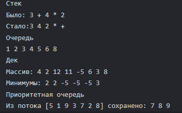

# Лабораторная работа №5: Стек, очередь, дек, приоритетная очередь

**Студент:** Хвостов Ростислав Романович

**Группа:** ПИЖ-б-о-25-2

**Вариант:** 11

## Цель работы
1. Реализовать основные линейные структуры данных: стек, очередь, дек и приоритетную очередь
2. Освоить принципы LIFO (стек) и FIFO (очередь)
3. Научиться реализовывать эти структуры на основе динамического массива и связного списка
4. Изучить применение стека для решения задач (проверка скобок, обратная польская запись)
5. Реализовать приоритетную очередь на основе кучи (heap)

## Теоретическое обоснование
- Стек - структура данных, работающая по принципу LIFO. Последний добавленный элемент извлекается первым.
- Очередь - структура данных, работающая по принципу FIFO. Первый добавленный элемент извлекается первым.
- Дек - двусторонняя очередь, позволяющая добавлять и удалять элементы с обоих концов.
- Приоритетная очередь - структура, в которой каждый элемент имеет приоритет; элемент с наибольшим или наименьшим приоритетом извлекается первым.

## Задания варианта:
- Стек: преобразование инфиксной записи в постфиксную (алгоритм сортировочной станции).
- Очередь: объединение двух очередей в одну с чередованием элементов.
- Дек: поиск минимумов во всех подмассивах (скользящих окнах) длины k.
- Приоритетная очередь: реализация очереди с фиксированной ёмкостью.

```с++
#include <iostream>
#include <string>
#include <stack>
#include <queue>
#include <deque>
#include <vector>
#include <stdexcept>
#include <algorithm>

using namespace std;

// Стек

int priority(char op) {
    if (op == '+' || op == '-') return 1;
    if (op == '*' || op == '/') return 2;
    return 0;
}

string infixToPostfix(const string& expr) {
    stack<char> st;
    string out;
    for (char ch : expr) {
        if (ch == ' ') {
            continue;
        }
        
        if (ch >= '0' && ch <= '9') {
            out += ch;
            out += ' ';
        } else if (ch == '(') {
            st.push(ch);
        } else if (ch == ')') {
            while (!st.empty() && st.top() != '(') {
                out += st.top();
                out += ' ';
                st.pop();
            }
            st.pop();
        } else {
            while (!st.empty() && st.top() != '(' && priority(st.top()) >= priority(ch)) {
                out += st.top(); out += ' ';
                st.pop();
            }
            st.push(ch);
        }
    }
    while (!st.empty()) {
        out += st.top(); out += ' ';
        st.pop();
    }
    return out;
}

// Очередь

queue<int> join(queue<int> q1, queue<int> q2) {
    queue<int> result;
    while (!q1.empty() || !q2.empty()) {
        if (!q1.empty()) {
            result.push(q1.front());
            q1.pop();
        }
        
        if (!q2.empty()) {
            result.push(q2.front());
            q2.pop();
        }
    }
    return result;
}

// Дек

vector<int> slidingWindowMin(const vector<int>& a, int k) {
    deque<int> dq;
    vector<int> res;
    for (int i = 0; i < (int)a.size(); i++) {
        while (!dq.empty() && a[dq.back()] >= a[i])
            dq.pop_back();
        dq.push_back(i);

        if (dq.front() <= i - k) {
            dq.pop_front();
        }
        
        if (i >= k - 1) {
            res.push_back(a[dq.front()]);
        }
    }
    return res;
}

// Приоритетная очередь

struct GreaterInt {
    bool operator()(int a, int b) const {
        return a > b;
    }
};

class FixedPriorityQueue {
private:
    vector<int> heap;
    int capacity;

public:
    explicit FixedPriorityQueue(int c) : capacity(c) {
        if (c <= 0) {
            throw invalid_argument("Вместимость должна быть больше 0");
        }
    }

    bool full() const {
        return heap.size() >= capacity;
    }
    
    bool empty() const {
        return heap.empty();
    }
    
    int size() const {
        return (int)heap.size();
    }

    void push(int value) {
        GreaterInt cmp;
        if (!full()) {
            heap.push_back(value);
            push_heap(heap.begin(), heap.end(), cmp);
        } else if (value > heap.front()) {
            pop_heap(heap.begin(), heap.end(), cmp);
            heap.back() = value;
            push_heap(heap.begin(), heap.end(), cmp);
        }
    }

    int top() const {
        if (empty()) {
            throw underflow_error("Очередь пуста");
        }
        
        return heap.front();
    }

    int pop() {
        GreaterInt cmp;
        if (empty()) {
            throw underflow_error("Очередь пуста");
        }
        
        pop_heap(heap.begin(), heap.end(), cmp);
        int v = heap.back();
        heap.pop_back();
        return v;
    }
};


int main() {
    cout << "Стек" << endl;
    cout << "Было: 3 + 4 * 2" << endl;
    cout << "Стало:" << infixToPostfix("3 + 4 * 2") << endl;

    cout << "Очередь" << endl;
    queue<int> q1, q2;
    for (int x : {1, 3, 5}) {
        q1.push(x);
    }
    
    for (int x : {2, 4, 6, 8}) {
        q2.push(x);
    }
    
    queue<int> result = join(q1, q2);
    while (!result.empty()) {
        cout << result.front() << " ";
        result.pop();
    }
    
    cout << endl;

    cout << "Дек" << endl;
    vector<int> a = {4, 2, 12, 11, -5, 6, 3, 8};
    
    cout << "Массив: ";
    for (int x : a) {
        cout << x << " ";
    }
    
    cout << endl << "Минимумы: ";
    for (int x : slidingWindowMin(a, 3)) {
        cout << x << " ";
    }
    
    cout << endl;

    cout << "Приоритетная очередь" << endl;
    FixedPriorityQueue pq(3);
    for (int x : {5, 1, 9, 3, 7, 2, 8}) {
        pq.push(x);
    }
    
    cout << "Из потока [5 1 9 3 7 2 8] сохранено: ";
    while (!pq.empty()) {
        cout << pq.pop() << " ";
    }

    return 0;
}
```

**Результат выполнения кода**


## Контрольные вопросы

1. В чём заключается принцип работы стека (LIFO)?
Ответ: Последний добавленный элемент извлекается первым. Все операции выполняются с одного конца.

2. В чём заключается принцип работы очереди (FIFO)?
Ответ: Первый добавленный элемент извлекается первым. Добавление в конец, извлечение из начала.

3. Чем дек отличается от обычной очереди?
Ответ: Дек позволяет добавлять и удалять элементы с обоих концов, а обычная очередь только с одного конца на вход и другого на выход.

4. Что такое приоритетная очередь? Где она применяется?
Ответ: Структура, в которой элемент с наибольшим приоритетом извлекается первым независимо от порядка добавления. Применяется в планировщиках задач, алгоритмах Дейкстры и Прима, задачах top-K.

5. Как реализовать стек на основе динамического массива?
Ответ: Хранить массив и индекс вершины. При добавлении записывать в следующую ячейку, при заполнении увеличивать массив вдвое. При удалении возвращать элемент по индексу вершины и уменьшать индекс.

6. Как реализовать очередь на основе кольцевого буфера?
Ответ: Хранить массив фиксированной ёмкости и два индекса. При добавлении записывать по индексу конца и сдвигать его по кругу. При извлечении брать элемент по индексу начала и сдвигать его по кругу.

7. Почему приоритетную очередь обычно реализуют на куче?
Ответ: Куча даёт логарифмическую сложность на вставку и извлечение экстремума и константную на доступ к нему, что оптимально.

8. Какова сложность операций push и pop в стеке?
Ответ: Константная для обеих, операции затрагивают только вершину.

9. Какова сложность операций enqueue и dequeue в очереди?
Ответ: Константная для обеих при реализации на кольцевом буфере или связном списке с указателями на начало и конец.

10. Какова сложность операций в приоритетной очереди? Почему?
Ответ: Вставка и извлечение логарифмические из-за просеивания по высоте кучи. Доступ к экстремуму константный, так как он всегда в корне.

11. Как проверить правильность расстановки скобок с помощью стека?
Ответ: Открывающую скобку класть в стек, при закрывающей проверять вершину на парность и снимать её. В конце стек должен быть пуст.

12. Как реализовать очередь на двух стеках? Какова сложность?
Ответ: Есть входной и выходной стеки. Добавление во входной. При извлечении если выходной пуст переливать в него всё из входного и снимать с выходного. Амортизированно константная сложность.

13. Как реализовать дек на основе двусвязного списка?
Ответ: Хранить указатели на начало и конец. Добавление и удаление с любого конца выполняются перестановкой соответствующего указателя.

## Вывод
Реализовали основные линейные структуры данных: стек, очередь, дек и приоритетную очередь. Освоили принципы LIFO и FIFO. Научились реализовывать эти структуры на основе динамического массива и связного списка. Изучили применение стека для решения задач. Реализовали приоритетную очередь на основе кучи (heap).
