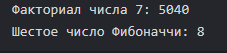
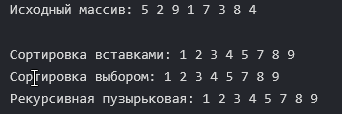

# Лабораторная работа №6: Рекурсивные алгоритмы

**Студент:** Хвостов Ростислав Романович

**Группа:** ПИЖ-б-о-25-2

**Вариант:** 11

## Цель работы
1. Освоить принципы рекурсии: прямой и косвенной, базовый случай и шаг рекурсии
2. Научиться применять рекурсию для решения практических задач (факториал, числа Фибоначчи, Ханойские башни, обход лабиринта)
3. Реализовать и сравнить простые алгоритмы сортировки: пузырьковую, вставками, выбором
4. Проанализировать сложность рекурсивных алгоритмов и простых сортировок
5. Сравнить рекурсивную и итеративную реализации одних и тех же алгоритмов

## Теоретическое обоснование
- Рекурсия - это приём, при котором функция вызывает саму себя для решения подзадачи меньшего размера.
- Перебор с возвратом (backtracking) - это разновидность рекурсивного перебора, при котором мы делаем выбор, рекурсивно исследуем его последствия и, если решение не найдено, отменяем выбор и пробуем следующий вариант

**Код к заданию:**

1. **Часть 1**
**Факториал и числа Фибоначчи:**

```с++
#include <iostream>

using namespace std;

int factorial(int n) {
    if (n <= 1) {
        return 1;
    }
    
    return n * factorial(n - 1);
}

int fibonacci(int n) {
    if (n <= 1) {
        return n;
    }
    
    return fibonacci(n - 1) + fibonacci(n - 2);
}

int main() {
	setlocale(LC_ALL, "ru");
	
    cout << "Факториал числа 7: " << factorial(7) << endl;
    cout << "Шестое число Фибоначчи: " << fibonacci(6);
}

```

**Результат выполнения кода**



Рекурсивные функции факториала и Фибоначчи имеют сложность O(n) и O(2ⁿ) соответственно.

**Обход лабиринта 6x6 и задача о ферзях 5x5:**

```c++
#include <iostream>

using namespace std;

const int N = 6;

char maze[N][N] = {
    {'S', 0, 0, 1, 0, 0},
    {1, 1, 0, 1, 0, 1},
    {0, 0, 0, 0, 0, 0},
    {0, 1, 1, 1, 1, 0},
    {0, 0, 0, 0, 1, 0},
    {1, 1, 1, 0, 0, 'F'}
};

bool visited[N][N] = {};
int pathX[N * N];
int pathY[N * N];
int pathLen = 0;

void printMaze() {
    for (int i = 0; i < N; i++) {
        for (int j = 0; j < N; j++) {
            if (maze[i][j] == 1) {
                cout << "# ";
            }
            else if (maze[i][j] == 'S') {
                cout << "S ";
            }
            else if (maze[i][j] == 'F') {
                cout << "F ";
            }
            else {
                cout << ". ";
            }
        }
        cout << endl;
    }
}

void printMazeWithPath() {
    for (int i = 0; i < N; i++) {
        for (int j = 0; j < N; j++) {
            bool onPath = false;
            for (int k = 0; k < pathLen; k++) {
                if (pathX[k] == i && pathY[k] == j) {
                    onPath = true;
                    break;
                }
            }
            if (maze[i][j] == 'S') {
                cout << "S ";
            }
            else if (maze[i][j] == 'F') {
                cout << "F ";
            }
            else if (maze[i][j] == 1) {
                cout << "# ";
            }
            else if (onPath) {
                cout << "* ";
            }
            else {
                cout << ". ";
            }
        }
        cout << endl;
    }
}

bool solveMaze(int x, int y) {
    if (x < 0 || x >= N || y < 0 || y >= N) {
        return false;
    }
    if (maze[x][y] == 1 || visited[x][y]) {
        return false;
    }
    visited[x][y] = true;
    pathX[pathLen] = x;
    pathY[pathLen] = y;
    pathLen++;
    if (maze[x][y] == 'F') {
        return true;
    }
    if (solveMaze(x + 1, y)) {
        return true;
    }
    if (solveMaze(x - 1, y)) {
        return true;
    }
    if (solveMaze(x, y + 1)) {
        return true;
    }
    if (solveMaze(x, y - 1)) {
        return true;
    }
    visited[x][y] = false;
    pathLen--;
    return false;
}

void runMaze() {
    cout << "Исходный лабиринт:\n";
    printMaze();
    cout << endl;
    
    if (solveMaze(0, 0)) {
        cout << "Путь найден (длина " << pathLen << "):\n";
        printMazeWithPath();
        cout << endl;
    }
    else {
        cout << "Пути нет" << endl;
    }
    cout << endl;
}

const int Q = 5;
int board[Q][Q] = {};
int solutions = 0;

bool isSafe(int row, int col) {
    for (int i = 0; i < row; i++) {
        if (board[i][col]) {
            return false;
        }
    }
    for (int i = row - 1, j = col - 1; i >= 0 && j >= 0; i--, j--) {
        if (board[i][j]) {
            return false;
        }
    }
    for (int i = row - 1, j = col + 1; i >= 0 && j < Q; i--, j++) {
        if (board[i][j]) {
            return false;
        }
    }
    return true;
}

void solveQueens(int row) {
    if (row == Q) {
        solutions++;
        cout << "Решение " << solutions << ":" << endl;
        for (int i = 0; i < Q; i++) {
            for (int j = 0; j < Q; j++) {
                if (board[i][j]) {
                    cout << "Q ";
                }
                else {
                    cout << ". ";
                }
            }
            cout << endl;
        }
        cout << endl;
        return;
    }
    for (int col = 0; col < Q; col++) {
        if (isSafe(row, col)) {
            board[row][col] = 1;
            solveQueens(row + 1);
            board[row][col] = 0;
        }
    }
}

void runQueens() {
    solveQueens(0);
    cout << "Всего решений: " << solutions << endl;
}

int main() {
    setlocale(LC_ALL, "ru");
    
    cout << "Лабиринт" << endl;
    runMaze();
    
    cout << "Задача о ферзях" << endl;
    runQueens();
    
    return 0;
}
```

**Результат выполнения кода**

```
Лабиринт
Исходный лабиринт:
S . . # . . 
# # . # . # 
. . . . . . 
. # # # # . 
. . . . # . 
# # # . . F 

Путь найден (длина 11):
S * * # . . 
# # * # . # 
. . * * * * 
. # # # # * 
. . . . # * 
# # # . . F 


Задача о ферзях
Решение 1:
Q . . . . 
. . Q . . 
. . . . Q 
. Q . . . 
. . . Q . 

Решение 2:
Q . . . . 
. . . Q . 
. Q . . . 
. . . . Q 
. . Q . . 

Решение 3:
. Q . . . 
. . . Q . 
Q . . . . 
. . Q . . 
. . . . Q 

Решение 4:
. Q . . . 
. . . . Q 
. . Q . . 
Q . . . . 
. . . Q . 

Решение 5:
. . Q . . 
Q . . . . 
. . . Q . 
. Q . . . 
. . . . Q 

Решение 6:
. . Q . . 
. . . . Q 
. Q . . . 
. . . Q . 
Q . . . . 

Решение 7:
. . . Q . 
Q . . . . 
. . Q . . 
. . . . Q 
. Q . . . 

Решение 8:
. . . Q . 
. Q . . . 
. . . . Q 
. . Q . . 
Q . . . . 

Решение 9:
. . . . Q 
. Q . . . 
. . . Q . 
Q . . . . 
. . Q . . 

Решение 10:
. . . . Q 
. . Q . . 
Q . . . . 
. . . Q . 
. Q . . . 

Всего решений: 10

```

Обход лабиринта в худшем случае перебирает все клетки - O(N²), где N - размер стороны. Задача о ферзях в худшем случае имеет сложность O(N!), но за счёт отсечения по вертикали и диагоналям на практике перебирает гораздо меньше вариантов.

2. **Часть 2. Сортировка вставками, выбором и рекурсивная пузырьковая**

```c++
#include <iostream>

using namespace std;

void print(int arr[], int n) {
    for (int i = 0; i < n; i++) {
        cout << arr[i] << " ";
    }
    cout << endl;
}

void insertionSort(int arr[], int n) {
    for (int i = 1; i < n; i++) {
        int key = arr[i];
        int j = i - 1;
        while (j >= 0 && arr[j] > key) {
            arr[j + 1] = arr[j];
            j--;
        }
        arr[j + 1] = key;
    }
}

void selectionSort(int arr[], int n) {
    for (int i = 0; i < n - 1; i++) {
        int minIdx = i;
        for (int j = i + 1; j < n; j++) {
            if (arr[j] < arr[minIdx]) {
                minIdx = j;
            }
        }
        if (minIdx != i) {
            int temp = arr[i];
            arr[i] = arr[minIdx];
            arr[minIdx] = temp;
        }
    }
}

void bubbleSortRecursive(int arr[], int n) {
    if (n <= 1) {
        return;
    }
    for (int i = 0; i < n - 1; i++) {
        if (arr[i] > arr[i + 1]) {
            int temp = arr[i];
            arr[i] = arr[i + 1];
            arr[i + 1] = temp;
        }
    }
    bubbleSortRecursive(arr, n - 1);
}

int main() {
    setlocale(LC_ALL, "ru");
    
    const int n = 8;
    int original[n] = {5, 2, 9, 1, 7, 3, 8, 4};
    int a[n];
    int b[n];
    int c[n];

    for (int i = 0; i < n; i++) {
        a[i] = original[i];
        b[i] = original[i];
        c[i] = original[i];
    }

    cout << "Исходный массив: ";
    print(original, n);
    cout << endl;

    insertionSort(a, n);
    cout << "Сортировка вставками: ";
    print(a, n);

    selectionSort(b, n);
    cout << "Сортировка выбором: ";
    print(b, n);

    bubbleSortRecursive(c, n);
    cout << "Рекурсивная пузырьковая: ";
    print(c, n);

    return 0;
}
```

**Результат выполнения кода**



Сортировки вставками и выбором работают за O(n²), рекурсивная пузырьковая - тоже O(n²), при этом глубина рекурсии равна n.

## Контрольные вопросы
1. Что такое рекурсия и какие два обязательных элемента должна содержать рекурсивная функция?
Ответ: Рекурсия — это вызов функцией самой себя. Обязательны база рекурсии (условие остановки, при котором вызов не происходит) и шаг рекурсии (сведение задачи к подзадаче меньшего размера).

2. Почему рекурсивное вычисление чисел Фибоначчи без мемоизации работает экспоненциально долго?
Ответ: Потому что fib(n) вызывает fib(n−1) и fib(n−2), и одни и те же значения пересчитываются заново огромное число раз — общее количество вызовов растёт как 2ⁿ.

3. В чём суть метода перебора с возвратом (backtracking)?
Ответ: Мы делаем очередной выбор, рекурсивно продолжаем поиск, а если он зашёл в тупик — отменяем выбор и пробуем следующий вариант. Так перебираются только допустимые частичные решения.

4. Зачем в обходе лабиринта нужен массив visited и как он связан с откатом?
Ответ: visited помечает уже посещённые клетки, чтобы не ходить по кругу. При откате из тупика метка снимается, чтобы клетку можно было использовать на другом пути.

5. Как формулируется база рекурсии в задаче обхода лабиринта?
Ответ: Мы дошли до клетки F (финиш) — возвращаем true и прекращаем дальнейший перебор. Также базой можно считать выход за границы или попадание в стену/посещённую клетку — тогда возвращаем false.

6. Как формулируется база рекурсии в задаче о ферзях?
Ответ: Когда номер текущей строки равен N (все N строк заполнены), значит, все N ферзей расставлены без конфликтов — фиксируем очередное решение.

7. Почему в задаче о ферзях мы ставим по одному ферзю в каждую строку?
Ответ: Потому что два ферзя в одной строке бьют друг друга, значит, в корректной расстановке в каждой строке ровно один ферзь. Это сразу сокращает перебор.

8. Какие направления проверяются при постановке ферзя и почему не проверяется горизонталь?
Ответ: Проверяются вертикаль и две диагонали. Горизонталь проверять не нужно, потому что мы и так ставим не более одного ферзя в строку.

9. Сколько решений имеет задача о ферзях для доски 5×5?
Ответ: Ровно 10 решений.

10. Что такое глубина рекурсии и чем она опасна?
Ответ: Глубина рекурсии — это максимальное число одновременно активных вызовов. При слишком большой глубине может произойти переполнение стека (stack overflow).

11. В чём разница между рекурсивной и итеративной реализацией одной и той же задачи?
Ответ: Итеративная использует циклы и не расходует стек вызовов, рекурсивная обычно короче и ближе к математическому определению, но тратит память на кадры стека.

12. Как работает сортировка вставками?
Ответ: Идём по массиву слева направо и каждый новый элемент вставляем в уже отсортированную левую часть, сдвигая все большие элементы на одну позицию вправо.

13. Как работает сортировка выбором?
Ответ: На позиции i ищем минимум в оставшейся части массива (от i до конца) и меняем его местами с элементом на позиции i. После этого первые i+1 элементов стоят на своих местах.

14. В чём отличие рекурсивной пузырьковой сортировки от обычной?
Ответ: Логика проходов та же (соседние пары меняются местами, максимум «всплывает» в конец), но внешний цикл заменён рекурсивным вызовом с длиной массива, уменьшенной на 1. База рекурсии — массив длины 0 или 1.

15. Какая из трёх реализованных сортировок лучше работает на почти отсортированных данных и почему?
Ответ: Сортировка вставками, потому что при почти отсортированном массиве внутренний while делает мало сдвигов — в лучшем случае O(n). Сортировка выбором всегда делает O(n²) сравнений независимо от входных данных.

## Вывод
Освоили принципы рекурсии: прямой и косвенной, базовый случай и шаг рекурсии. Научились применять рекурсию для решения практических задач. Реализовали и сравнили простые алгоритмы сортировки. Сравнили рекурсивную и итеративную реализации одних и тех же алгоритмов.
