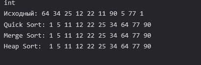
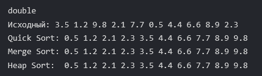
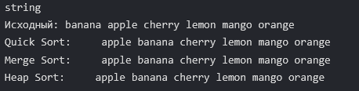

# Лабораторная работа №7: Быстрая сортировка, сортировка слиянием, пирамидальная сортировка

**Студент:** Хвостов Ростислав Романович

**Группа:** ПИЖ-б-о-25-2

**Вариант:** 11

## Цель работы
1. Реализовать три эффективных алгоритма сортировки: быструю сортировку (Quick Sort), сортировку слиянием (Merge Sort) и пирамидальную сортировку (Heap Sort)
2. Освоить принципы «разделяй и властвуй» на примере быстрой сортировки и сортировки слиянием
3. Изучить структуру данных «куча» (heap) для реализации пирамидальной сортировки
4. Проанализировать и сравнить производительность различных алгоритмов сортировки
5. Понять преимущества и недостатки каждого алгоритма в различных сценариях использования

## Теоретическое обоснование
- Быстрая сортировка работает по следующему принципу: выбирается опорный элемент, массив разделяется на элементы меньше и больше опорного, затем обе части сортируются рекурсивно
- Сортировка слиянием тоже использует принцип "разделяй и властвуй": массив делится пополам, каждая половина сортируется рекурсивно, затем две отсортированные половины сливаются в один массив
- Пирамидальная сортировка основана на куче: сначала из массива строится куча, затем корень меняется с последним элементом и куча восстанавливается на уменьшенном префиксе

## Задание
**Средний уровень:** все три сортировки - протестировать на различных типах данных (int, double, string).

## Код задания

```cpp
#include <iostream>
#include <string>

using namespace std;

template <typename T>
void swapValues(T& a, T& b) {
    T temp = a;
    a = b;
    b = temp;
}

template <typename T>
int partition(T arr[], int low, int high) {
    T pivot = arr[high];
    int i = low - 1;
    for (int j = low; j < high; j++) {
        if (arr[j] <= pivot) {
            i++;
            swapValues(arr[i], arr[j]);
        }
    }
    swapValues(arr[i + 1], arr[high]);
    return i + 1;
}

template <typename T>
void quickSort(T arr[], int low, int high) {
    if (low < high) {
        int pi = partition(arr, low, high);
        quickSort(arr, low, pi - 1);
        quickSort(arr, pi + 1, high);
    }
}

template <typename T>
void merge(T arr[], int left, int mid, int right) {
    int n1 = mid - left + 1;
    int n2 = right - mid;
    T* L = new T[n1];
    T* R = new T[n2];
    for (int i = 0; i < n1; i++) {
        L[i] = arr[left + i];
    }
    for (int j = 0; j < n2; j++) {
        R[j] = arr[mid + 1 + j];
    }
    int i = 0;
    int j = 0;
    int k = left;
    while (i < n1 && j < n2) {
        if (L[i] <= R[j]) {
            arr[k] = L[i];
            i++;
        }
        else {
            arr[k] = R[j];
            j++;
        }
        k++;
    }
    while (i < n1) {
        arr[k] = L[i];
        i++;
        k++;
    }
    while (j < n2) {
        arr[k] = R[j];
        j++;
        k++;
    }
    delete[] L;
    delete[] R;
}

template <typename T>
void mergeSort(T arr[], int left, int right) {
    if (left < right) {
        int mid = left + (right - left) / 2;
        mergeSort(arr, left, mid);
        mergeSort(arr, mid + 1, right);
        merge(arr, left, mid, right);
    }
}

template <typename T>
void heapify(T arr[], int n, int i) {
    int largest = i;
    int left = 2 * i + 1;
    int right = 2 * i + 2;
    if (left < n && arr[left] > arr[largest]) {
        largest = left;
    }
    if (right < n && arr[right] > arr[largest]) {
        largest = right;
    }
    if (largest != i) {
        swapValues(arr[i], arr[largest]);
        heapify(arr, n, largest);
    }
}

template <typename T>
void heapSort(T arr[], int n) {
    for (int i = n / 2 - 1; i >= 0; i--) {
        heapify(arr, n, i);
    }
    for (int i = n - 1; i > 0; i--) {
        swapValues(arr[0], arr[i]);
        heapify(arr, i, 0);
    }
}

template <typename T>
void print(T arr[], int n) {
    for (int i = 0; i < n; i++) {
        cout << arr[i] << " ";
    }
    cout << endl;
}

template <typename T>
void copyArray(T src[], T dst[], int n) {
    for (int i = 0; i < n; i++) {
        dst[i] = src[i];
    }
}

int main() {
    setlocale(LC_ALL, "ru");
    
    const int n = 10;

    int intArr[n] = {64, 34, 25, 12, 22, 11, 90, 5, 77, 1};
    double doubleArr[n] = {3.5, 1.2, 9.8, 2.1, 7.7, 0.5, 4.4, 6.6, 8.9, 2.3};
    string stringArr[n] = {"banana", "apple", "cherry", "lemon", "mango", "orange"};

    int intCopy[n];
    double doubleCopy[n];
    string stringCopy[n];

    cout << "int" << endl;
    cout << "Исходный: ";
    print(intArr, n);

    copyArray(intArr, intCopy, n);
    quickSort(intCopy, 0, n - 1);
    cout << "Quick Sort: ";
    print(intCopy, n);

    copyArray(intArr, intCopy, n);
    mergeSort(intCopy, 0, n - 1);
    cout << "Merge Sort: ";
    print(intCopy, n);

    copyArray(intArr, intCopy, n);
    heapSort(intCopy, n);
    cout << "Heap Sort: ";
    print(intCopy, n);
    cout << endl;

    cout << "double" << endl;
    cout << "Исходный: ";
    print(doubleArr, n);

    copyArray(doubleArr, doubleCopy, n);
    quickSort(doubleCopy, 0, n - 1);
    cout << "Quick Sort: ";
    print(doubleCopy, n);

    copyArray(doubleArr, doubleCopy, n);
    mergeSort(doubleCopy, 0, n - 1);
    cout << "Merge Sort: ";
    print(doubleCopy, n);

    copyArray(doubleArr, doubleCopy, n);
    heapSort(doubleCopy, n);
    cout << "Heap Sort:  ";
    print(doubleCopy, n);
    cout << endl;

    cout << "string" << endl;
    cout << "Исходный: ";
    print(stringArr, n);

    copyArray(stringArr, stringCopy, n);
    quickSort(stringCopy, 0, n - 1);
    cout << "Quick Sort: ";
    print(stringCopy, n);

    copyArray(stringArr, stringCopy, n);
    mergeSort(stringCopy, 0, n - 1);
    cout << "Merge Sort: ";
    print(stringCopy, n);

    copyArray(stringArr, stringCopy, n);
    heapSort(stringCopy, n);
    cout << "Heap Sort: ";
    print(stringCopy, n);

    return 0;
}
```

## Результаты работы







## Ответы на контрольные вопросы
1. Какова сложность быстрой сортировки в лучшем, среднем и худшем случае?
Ответ: лучший и средний — O(n log n), худший — O(n²).

2. Когда возникает худший случай для быстрой сортировки?
Ответ: когда опорный элемент на каждом шаге оказывается минимальным или максимальным — например, при выборе последнего элемента на уже отсортированном массиве.

3. Как можно улучшить быструю сортировку для защиты от худшего случая?
Ответ: выбирать опорный элемент как медиану из трёх, использовать случайный pivot или переходить на сортировку вставками для маленьких подмассивов.

4. Какова сложность сортировки слиянием? Почему она всегда O(n log n)?
Ответ: O(n log n) во всех случаях, потому что массив всегда делится строго пополам (глубина log n) и на каждом уровне выполняется линейное слияние.

5. Какие преимущества и недостатки имеет сортировка слиянием перед быстрой?
Ответ: преимущества — гарантированное O(n log n) и устойчивость; недостатки — требует O(n) дополнительной памяти и на практике обычно медленнее быстрой из-за копирований.

6. Как работает пирамидальная сортировка? Какова её сложность?
Ответ: строится max-куча, затем максимум (корень) меняется с последним элементом и куча восстанавливается на уменьшенном префиксе. Сложность всегда O(n log n).

7. Какая из трёх сортировок устойчивая? Почему?
Ответ: сортировка слиянием, потому что при слиянии равные элементы берутся из левой половины раньше, чем из правой, — их взаимный порядок сохраняется.

8. Какая из трёх сортировок требует дополнительной памяти? Сколько?
Ответ: сортировка слиянием — O(n) под временные массивы; быстрая — O(log n) на стек рекурсии; пирамидальная — O(1).

9. Какая из трёх сортировок лучше работает на почти отсортированных данных?
Ответ: сортировка слиянием и пирамидальная — обе стабильно O(n log n). Быстрая с выбором последнего элемента деградирует к O(n²).

10. Зачем в пирамидальной сортировке сначала строится куча?
Ответ: чтобы получить свойство max-кучи (родитель ≥ детей), тогда корень сразу даёт максимальный элемент, и его можно за O(log n) отправить в конец и восстановить кучу.

11. Что такое «разделяй и властвуй»? Как он применяется в быстрой сортировке и сортировке слиянием?
Ответ: приём, при котором задача делится на независимые подзадачи меньшего размера, они решаются рекурсивно, а результаты объединяются. В быстрой — разделение по pivot и рекурсия по частям; в слиянии — деление пополам и слияние отсортированных половин.

12. Можно ли реализовать быструю сортировку итеративно (без рекурсии)?
Ответ: да, с помощью явного стека, в который кладутся границы подмассивов.

13. Почему быстрая сортировка обычно быстрее сортировки слиянием на практике?
Ответ: она работает на месте, без копирований в дополнительные массивы, и лучше использует кэш процессора; константа в O(n log n) у неё меньше.

14. Когда выгодно использовать пирамидальную сортировку?
Ответ: когда важна гарантия O(n log n) в худшем случае и O(1) дополнительной памяти — например, во встроенных системах с жёсткими ограничениями по памяти.

15. Какой алгоритм сортировки вы бы выбрали для встроенных систем с ограниченной памятью?
Ответ: пирамидальную — она единственная из трёх требует O(1) дополнительной памяти и даёт гарантированное O(n log n).

## Выводы
Реализовали три эффективных алгоритма сортировки: быструю сортировку (Quick Sort), сортировку слиянием (Merge Sort) и пирамидальную сортировку (Heap Sort). Освоили принципы «разделяй и властвуй» на примере быстрой сортировки и сортировки слиянием. Изучили структуру данных «куча» (heap) для реализации пирамидальной сортировки. Проанализировали и сравнили производительность различных алгоритмов сортировки. Поняли преимущества и недостатки каждого алгоритма в различных сценариях использования.
