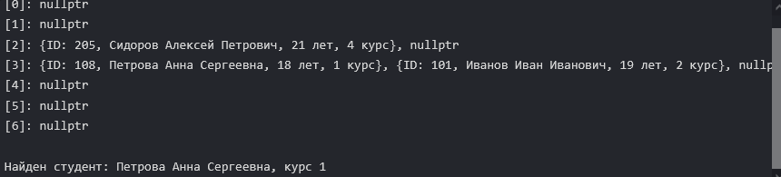

# Лабораторная работа №8: Двоичный поиск. Хеш-таблицы

**Студент:** Хвостов Ростислав Романович

**Группа:** ПИЖ-б-о-25-2

**Вариант:** 11

## Цель работы
1. Реализовать алгоритм двоичного (бинарного) поиска в отсортированном массиве
2. Освоить итеративную и рекурсивную реализации двоичного поиска
3. Изучить понятие хеш-таблицы, хеш-функции и методы разрешения коллизий
4. Реализовать хеш-таблицу с методом цепочек и открытой адресацией
5. Сравнить производительность двоичного поиска и хеш-таблицы

## Теоретическое обоснование
- Двоичный поиск работает только на отсортированном массиве: на каждом шаге берётся средний элемент, сравнивается с искомым, и интервал поиска сужается вдвое
- Хеш-таблица - это структура данных, которая по ключу вычисляет индекс в массиве с помощью хеш-функции и хранит пары ключ-значение в соответствующей ячейке
- Коллизия - ситуация, когда два разных ключа дают одинаковый хеш.

## Задание
**Часть 1** двоичный поиск в массиве, отсортированном по убыванию.

**Код:**

```c++
#include <iostream>
using namespace std;

int binarySearchReverse(const int arr[], int len, int target) {
    int left = 0;
    int right = len - 1;
    
    while (left <= right) {
        int mid = left + (right - left) / 2;
        if (arr[mid] == target) {
            return mid;
        }
        
        if (arr[mid] < target) {
            right = mid - 1;
        }
        else {
            left = mid + 1;
        }
    }
    return -1;
}

int main() {
    setlocale(LC_ALL, "ru");
    
	int arr[12] = {78, 69, 67, 64, 52, 49, 42, 33, 25, 1, 0, -4};
	
	int res = binarySearchReverse(arr, 12, 42);
	cout << "Индекс искомого элемента: " << res;
	
    return 0;
}

```

**Результат выполнения кода**


**Часть 2** хеш-таблица с методом цепочек, ключ типа int, значение типа struct Student.

**Код:**

```c++
#include <iostream>
#include <string>
#include <vector>

using namespace std;

struct Student {
    string name;
    int age;
    int course;
};

template <typename K, typename V>
struct Node {
    K key;
    V value;
    Node* next;

    Node(const K& k, const V& v) : key(k), value(v), next(nullptr) {}
};

template <typename K, typename V>
class HashTable {
private:
    vector<Node<K, V>*> table;
    int capacity;

    int hash(const K& key) const {
        return static_cast<unsigned int>(key) % capacity;
    }

public:
    HashTable(int cap) : capacity(cap), table(cap, nullptr) {}

    void insert(const K& key, const V& value) {
        int index = hash(key);
        Node<K, V>* current = table[index];

        while (current != nullptr) {
            if (current->key == key) {
                current->value = value;
                return;
            }
            current = current->next;
        }

        Node<K, V>* newNode = new Node<K, V>(key, value);
        newNode->next = table[index];
        table[index] = newNode;
    }

    V* find(const K& key) const {
        int index = hash(key);
        Node<K, V>* current = table[index];
        while (current != nullptr) {
            if (current->key == key) {
                return &current->value;
            }
            current = current->next;
        }
        return nullptr;
    }

    bool remove(const K& key) {
        int index = hash(key);
        Node<K, V>* current = table[index];
        Node<K, V>* prev = nullptr;

        while (current != nullptr) {
            if (current->key == key) {
                if (prev == nullptr) {
                    table[index] = current->next;
                } else {
                    prev->next = current->next;
                }
                delete current;
                return true;
            }
            prev = current;
            current = current->next;
        }
        return false;
    }

    void print() const {
        for (int i = 0; i < capacity; ++i) {
            cout << "[" << i << "]: ";
            Node<K, V>* current = table[i];
            while (current != nullptr) {
                cout << "{ID: " << current->key << ", "
                     << current->value.name << ", "
                     << current->value.age << " лет, "
                     << current->value.course << " курс}, ";
                current = current->next;
            }
            cout << "nullptr" << endl;
        }
    }
};

int main() {
    setlocale(LC_ALL, "ru");

    HashTable<int, Student> ht(7);

    ht.insert(101, {"Иванов Иван Иванович", 19, 2});
    ht.insert(108, {"Петрова Анна Сергеевна", 18, 1});
    ht.insert(205, {"Сидоров Алексей Петрович", 21, 4});

    ht.print();

    Student* s = ht.find(108);
    if (s != nullptr) {
        cout << endl << "Найден студент: " << s->name << ", курс " << s->course << endl;
    }

    return 0;
}

```

**Результат выполнения кода**



## Контрольные вопросы
1. Какое условие необходимо для применения двоичного поиска?
Ответ: массив должен быть отсортирован.

2. Какова сложность двоичного поиска? Почему она логарифмическая?
Ответ: O(log n), потому что на каждом шаге интервал поиска уменьшается вдвое.

3. В чём разница между итеративной и рекурсивной реализацией двоичного поиска?
Ответ: итеративная использует цикл и O(1) памяти, рекурсивная вызывает себя и тратит O(log n) памяти на стек вызовов.

4. Чем опасен вариант mid = (left + right) / 2? Как правильно вычислять середину?
Ответ: при больших left и right может произойти переполнение int. Правильно mid = left + (right - left) / 2.

5. Что такое хеш-таблица? Из каких компонентов она состоит?
Ответ: структура данных для хранения пар ключ-значение). Состоит из массива ячеек, хеш-функции и механизма разрешения коллизий.

6. Какие требования предъявляются к хеш-функции?
Ответ: детерминированность, равномерное распределение, быстрое вычисление.

7. Что такое коллизия в хеш-таблице? Как с ней бороться?
Ответ: ситуация, когда два разных ключа дают одинаковый индекс. Борются методом цепочек или открытой адресацией.

8. В чём отличие метода цепочек от открытой адресации?
Ответ: при цепочках коллизии хранятся в связных списках внутри ячейки, при открытой адресации все элементы лежат в самом массиве, а при коллизии ищется другая свободная ячейка.

9. Что такое первичная и вторичная кластеризация?
Ответ: первичная - при линейном пробировании, когда подряд идущие занятые ячейки сливаются в длинные блоки, вторичная - при квадратичном пробировании, когда ключи с одинаковым хешем идут одной последовательностью.

10. Какова средняя и худшая сложность операций в хеш-таблице?
Ответ: средняя - O(1), худшая - O(n).

11. Когда эффективнее использовать двоичный поиск, а когда — хеш-таблицу?
Ответ: двоичный поиск - когда данные уже отсортированы и нужно только искать, без частых вставок и удалений. Хеш-таблица - когда нужны быстрые вставка, поиск и удаление по ключу.

12. Что такое коэффициент загрузки хеш-таблицы? Почему он важен?
Ответ: отношение числа элементов к числу ячеек. Чем он выше, тем больше коллизий и тем медленнее операции.

13. Как работает рехеширование (динамическое расширение хеш-таблицы)?
Ответ: при превышении порога коэффициента загрузки создаётся новый массив большего размера, все элементы пересчитываются новой хеш-функцией и переносятся в него.

14. Как выбрать размер хеш-таблицы? Почему часто выбирают простое число?
Ответ: размер выбирают так, чтобы коэффициент загрузки был меньше 0.75. Простое число уменьшает число коллизий, потому что ключи распределяются равномернее по модулю.

15. Как реализовать хеш-функцию для строк?
Ответ: например, полиномиальный хеш: hash = (hash * 31 + c) % size для каждого символа c строки.

## Выводы
Реализовали алгоритм двоичного (бинарного) поиска в отсортированном массиве. Освоили итеративную и рекурсивную реализации двоичного поиска. Изучили понятие хеш-таблицы, хеш-функции и методы разрешения коллизий. Реализовали хеш-таблицу с методом цепочек и открытой адресацией. Сравнили производительность двоичного поиска и хеш-таблицы.
